# Feature 09: Feature tutorials

[Checklist](README.md) | [Previous](08-home-and-navigation.md) | [Next](10-profile-editing.md)

Click the underlined file path inside a diagram box to open the code. Line ranges show the beginning and end of the code group.

```mermaid
flowchart TD
    A["01. <a href='../../lib/screens/homescreen/screens/home_screen.dart#L64' style='text-decoration:underline'>lib/screens/homescreen/screens<br/>home_screen.dart:64-73</a><br/>Prepare Home and ask whether its guide should start"]
    B["02. <a href='../../lib/screens/onboarding/tours/home_drawer_tour.dart#L7' style='text-decoration:underline'>lib/screens/onboarding/tours<br/>home_drawer_tour.dart:7-127</a><br/>Choose what to highlight and prepare the page or drawer"]
    C["03. <a href='../../lib/screens/onboarding/widgets/screen_feature_tour.dart#L71' style='text-decoration:underline'>lib/screens/onboarding/widgets<br/>screen_feature_tour.dart:71-121</a><br/>For other screens, load their guide and wait for visible targets<br/>Then request a start: <a href='../../lib/screens/onboarding/widgets/screen_feature_tour.dart#L188' style='text-decoration:underline'>screen_feature_tour.dart:188-204</a>"]
    D["04. <a href='../../lib/screens/onboarding/tours/feature_tour_catalog.dart#L1' style='text-decoration:underline'>lib/screens/onboarding/tours<br/>feature_tour_catalog.dart:1-132</a><br/>Keep each guide's target order and English or Filipino explanations"]
    E["05. <a href='../../lib/screens/onboarding/widgets/screen_feature_tour.dart#L288' style='text-decoration:underline'>lib/screens/onboarding/widgets<br/>screen_feature_tour.dart:288-342</a><br/>Match a wrapped widget to its guide ID and create its highlight wrapper"]
    F["06. <a href='../../lib/screens/onboarding/controllers/feature_tour_controller.dart#L117' style='text-decoration:underline'>lib/screens/onboarding/controllers<br/>feature_tour_controller.dart:117-172</a><br/>Check that the right user and screen are ready for the guide"]
    G["07. <a href='../../lib/screens/onboarding/services/feature_tour_progress_service.dart#L10' style='text-decoration:underline'>lib/screens/onboarding/services<br/>feature_tour_progress_service.dart:10-17</a><br/>Read whether this user has already seen this guide"]
    H{"Was this guide already seen, without choosing Replay?"}
    I["08. <a href='../../lib/screens/onboarding/controllers/feature_tour_controller.dart#L211' style='text-decoration:underline'>lib/screens/onboarding/controllers<br/>feature_tour_controller.dart:211-250</a><br/>Make the next item visible and start its highlight"]
    J["09. <a href='../../lib/screens/onboarding/widgets/feature_showcase.dart#L29' style='text-decoration:underline'>lib/screens/onboarding/widgets<br/>feature_showcase.dart:29-64</a><br/>ShowcaseView draws the highlight and dark background"]
    K["10. <a href='../../lib/screens/onboarding/widgets/feature_tour_tooltip.dart#L13' style='text-decoration:underline'>lib/screens/onboarding/widgets<br/>feature_tour_tooltip.dart:13-224</a><br/>Position the explanation card and wire Back, Next, Done and Skip<br/>Button calls: <a href='../../lib/screens/onboarding/widgets/feature_tour_tooltip.dart#L192' style='text-decoration:underline'>feature_tour_tooltip.dart:192-215</a>"]
    L["11. <a href='../../lib/screens/onboarding/controllers/feature_tour_controller.dart#L174' style='text-decoration:underline'>lib/screens/onboarding/controllers<br/>feature_tour_controller.dart:174-208</a><br/>Handle Next, Back, Skip and cancellation"]
    M["12. <a href='../../lib/screens/onboarding/controllers/feature_tour_journey.dart#L28' style='text-decoration:underline'>lib/screens/onboarding/controllers<br/>feature_tour_journey.dart:28-64</a><br/>Carry the same guide and step count into another screen<br/>Caller: <a href='../../lib/screens/onboarding/widgets/screen_feature_tour.dart#L213' style='text-decoration:underline'>screen_feature_tour.dart:213-231</a>"]
    END["<a href='../../lib/screens/onboarding/controllers/feature_tour_controller.dart#L261' style='text-decoration:underline'>lib/screens/onboarding/controllers<br/>feature_tour_controller.dart:261-282</a><br/>Close the highlight, stop its timer and run screen cleanup<br/>Finish or Skip requests a save; Cancel does not"]
    N["13. <a href='../../lib/screens/onboarding/services/feature_tour_progress_service.dart#L19' style='text-decoration:underline'>lib/screens/onboarding/services<br/>feature_tour_progress_service.dart:19-22</a><br/>Save featureId: true in users/UID/onboarding/features"]
    HOME["<a href='../../lib/screens/homescreen/screens/home_screen.dart#L75' style='text-decoration:underline'>lib/screens/homescreen/screens<br/>home_screen.dart:75-84</a><br/>Home wraps its controls with FeatureShowcase through guide"]
    REGISTER["<a href='../../lib/screens/onboarding/controllers/feature_tour_controller.dart#L22' style='text-decoration:underline'>lib/screens/onboarding/controllers<br/>feature_tour_controller.dart:22-55</a><br/>Register a separate ShowcaseView scope for this controller"]
    REPLAY["Replay requests start with replay: true<br/>Home: <a href='../../lib/screens/homescreen/screens/home_screen.dart#L186' style='text-decoration:underline'>home_screen.dart:186-186</a><br/>Other screens: <a href='../../lib/screens/onboarding/widgets/screen_feature_tour.dart#L206' style='text-decoration:underline'>screen_feature_tour.dart:206-211</a>"]
    CLEANUP["<a href='../../lib/screens/onboarding/controllers/feature_tour_controller.dart#L284' style='text-decoration:underline'>lib/screens/onboarding/controllers<br/>feature_tour_controller.dart:284-345</a><br/>Pause for interruptions, resume the same step, and release resources on disposal"]
    O["Do not start the guide automatically"]
    A --> B --> REGISTER --> F
    B -. "Home target wrappers" .-> HOME
    C --> REGISTER
    C -. "Read catalog" .-> D
    D --> E
    E -. "Creates the wrapper used when highlighted" .-> J
    HOME -. "Creates the wrapper used when highlighted" .-> J
    F --> G --> H
    H -- Yes --> O
    H -- No --> I --> J --> K --> L
    L -- "Another step" --> I
    L -- "Another screen" --> M --> C
    L -- Back --> I
    L -- "Finish or Skip" --> END
    L -- Cancel --> END
    END -- "Mark as seen requested" --> N
    END -- "Cancel; leave saved progress unchanged" --> O
    REPLAY --> F
    F -. "While running or when disposed" .-> CLEANUP
```

