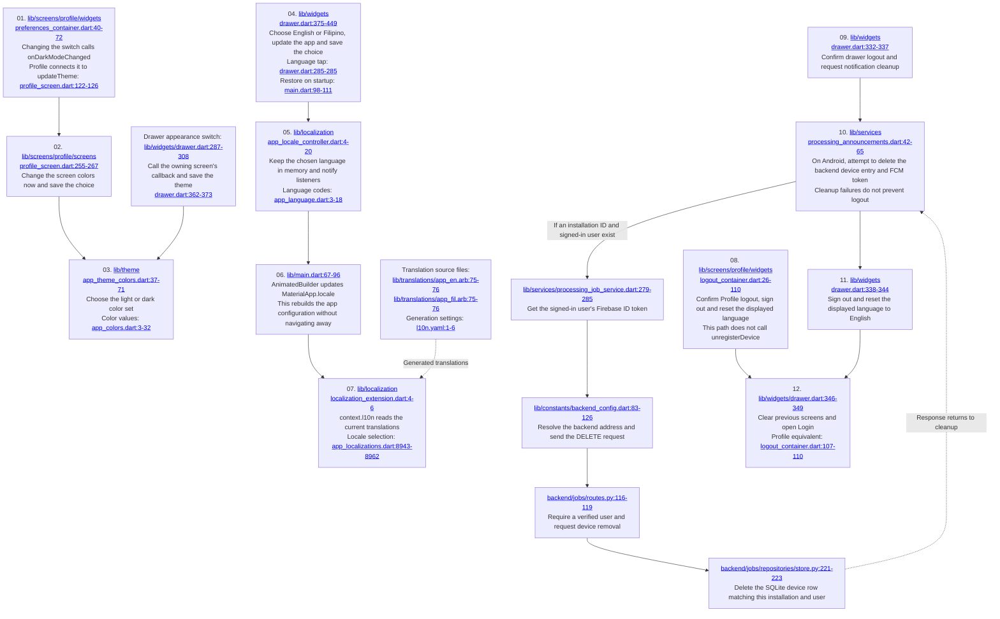

# Feature 11: Appearance, language and logout

[Checklist](README.md) | [Previous](10-profile-editing.md) | [Next](12-sheet-selection-and-preview.md)

Click the underlined file path inside a diagram box to open the code. Line ranges show the beginning and end of the code group.

