# Feature 14: Submitting sheet-recognition requests

[Checklist](README.md) | [Previous](13-sheet-upload-and-saving.md) | [Next](15-sheet-recognition-processing.md)

Click the underlined file path inside a diagram box to open the code. Line ranges show the beginning and end of the code group.

```mermaid
flowchart TD
    A["01. <a href='../../lib/screens/music_sheet/screens/music_sheet_viewer_screen.dart#L1323' style='text-decoration:underline'>lib/screens/music_sheet/screens<br/>music_sheet_viewer_screen.dart:1323-1358</a><br/>Ask for confirmation, then send this sheet for recognition"]
    B["02. <a href='../../lib/screens/music_sheet/services/music_sheet_omr_service.dart#L3' style='text-decoration:underline'>lib/screens/music_sheet/services<br/>music_sheet_omr_service.dart:3-8</a><br/>Build the recognition endpoint using this sheet ID"]
    C["03. <a href='../../lib/services/processing_job_service.dart#L85' style='text-decoration:underline'>lib/services<br/>processing_job_service.dart:85-110</a><br/>Identify the signed-in user and prevent duplicate requests"]
    SEND["<a href='../../lib/services/processing_job_service.dart#L112' style='text-decoration:underline'>lib/services/processing_job_service.dart:112-162</a><br/>Keep a request key for safe retries and POST with authentication<br/>Token helper: <a href='../../lib/services/processing_job_service.dart#L279' style='text-decoration:underline'>processing_job_service.dart:279-285</a>"]
    D["04. <a href='../../lib/constants/backend_config.dart#L41' style='text-decoration:underline'>lib/constants<br/>backend_config.dart:41-71</a><br/>Use a configured address or discover baseUrl from appConfig/backend<br/>Send and retry after an address change: <a href='../../lib/constants/backend_config.dart#L83' style='text-decoration:underline'>backend_config.dart:83-126</a>"]
    E["05. <a href='../../backend/jobs/routes.py#L63' style='text-decoration:underline'>backend/jobs<br/>routes.py:63-65</a><br/>Receive the recognition request and check sign-in"]
    CHECK["Validate request headers: <a href='../../backend/jobs/routes.py#L15' style='text-decoration:underline'>backend/jobs/routes.py:15-21</a><br/>Verify the Firebase token and email: <a href='../../backend/core/auth_service.py#L40' style='text-decoration:underline'>backend/core/auth_service.py:40-105</a><br/>Return the verified user's UID as owner"]
    F["06. <a href='../../backend/jobs/routes.py#L24' style='text-decoration:underline'>backend/jobs<br/>routes.py:24-60</a><br/>Reuse a matching request and check that the worker is running<br/>Saved request lookup: <a href='../../backend/jobs/repositories/store.py#L91' style='text-decoration:underline'>store.py:91-97</a><br/>Worker heartbeat: <a href='../../backend/jobs/repositories/store.py#L210' style='text-decoration:underline'>store.py:210-213</a>"]
    G["07. <a href='../../backend/jobs/repositories/firebase_bridge.py#L33' style='text-decoration:underline'>backend/jobs/repositories<br/>firebase_bridge.py:33-61</a><br/>Remember which sheet and file versions will be processed"]
    H["08. <a href='../../backend/omr/repositories/music_sheet_repository.py#L60' style='text-decoration:underline'>backend/omr/repositories<br/>music_sheet_repository.py:60-81</a><br/>Check that the sheet exists and belongs to this user<br/>Validate source paths and pages: <a href='../../backend/omr/repositories/music_sheet_repository.py#L4' style='text-decoration:underline'>music_sheet_repository.py:4-57</a>"]
    I["09. <a href='../../backend/jobs/repositories/store.py#L99' style='text-decoration:underline'>backend/jobs/repositories<br/>store.py:99-123</a><br/>Reserve a place in the waiting list, if the limits allow it"]
    J["10. <a href='../../backend/jobs/repositories/firebase_bridge.py#L64' style='text-decoration:underline'>backend/jobs/repositories<br/>firebase_bridge.py:64-87</a><br/>Mark the sheet as queued and save its processingJobs record<br/>Reject a changed sheet or an existing active job"]
    K["11. <a href='../../backend/jobs/repositories/store.py#L125' style='text-decoration:underline'>backend/jobs/repositories<br/>store.py:125-127</a><br/>Make the prepared job available to the worker"]
    L["12. <a href='../../backend/jobs/repositories/store.py#L244' style='text-decoration:underline'>backend/jobs/repositories<br/>store.py:244-252</a><br/>Build the response containing jobId and status<br/>The API route sends HTTP 202 Accepted"]
    RESPONSE["<a href='../../lib/services/processing_job_service.dart#L143' style='text-decoration:underline'>lib/services/processing_job_service.dart:143-162</a><br/>Read the accepted job and start status tracking<br/>Tracking: <a href='../../lib/services/processing_job_service.dart#L164' style='text-decoration:underline'>processing_job_service.dart:164-200</a>"]
    UI["<a href='../../lib/screens/music_sheet/screens/music_sheet_viewer_screen.dart#L427' style='text-decoration:underline'>lib/screens/music_sheet/screens/music_sheet_viewer_screen.dart:427-449</a><br/>Show acceptance or a readable submission error<br/>The separate worker processes the job in Feature 15"]
    A --> B --> C --> SEND --> D --> E --> CHECK --> F
    F -- "New request" --> G --> H
    H -- "Return validated sheet to inspect_target" --> G
    G -- "Return snapshot and revision" --> I --> J --> K --> L
    F -- "Existing accepted request" --> L
    L -- "HTTP response returns through address helper" --> RESPONSE --> UI
```

