# Feature 15: Recognizing sheets and saving results

[Checklist](README.md) | [Previous](14-sheet-recognition-requests.md) | [Next](16-audio-and-video-uploads.md)

Click the underlined file path inside a diagram box to open the code. Line ranges show the beginning and end of the code group.

```mermaid
flowchart TD
    A["01. <a href='../../backend/jobs/worker.py#L78' style='text-decoration:underline'>backend/jobs<br/>worker.py:78-188</a><br/>Recover unfinished jobs, update the heartbeat and look for queued work<br/>Single-worker lock: <a href='../../backend/jobs/process_guard.py#L72' style='text-decoration:underline'>process_guard.py:72-91</a>"]
    B["02. <a href='../../backend/jobs/repositories/store.py#L138' style='text-decoration:underline'>backend/jobs/repositories<br/>store.py:138-147</a><br/>Take the oldest waiting job, one processing job at a time"]
    START["<a href='../../backend/jobs/repositories/firebase_bridge.py#L90' style='text-decoration:underline'>backend/jobs/repositories/firebase_bridge.py:90-108</a><br/>Confirm the sheet still belongs to this job<br/>Update Firestore status to processing"]
    C["03. <a href='../../backend/jobs/runner.py#L6' style='text-decoration:underline'>backend/jobs<br/>runner.py:6-19</a><br/>Load the claimed job in a separate process and execute it<br/>Worker launches it: <a href='../../backend/jobs/worker.py#L164' style='text-decoration:underline'>worker.py:164-172</a><br/>Process starts with authorization: <a href='../../backend/jobs/process_guard.py#L43' style='text-decoration:underline'>process_guard.py:43-57</a>"]
    D["04. <a href='../../backend/jobs/processors.py#L5' style='text-decoration:underline'>backend/jobs<br/>processors.py:5-15</a><br/>Check the source versions and choose the recognition processor<br/>Source check: <a href='../../backend/jobs/repositories/firebase_bridge.py#L111' style='text-decoration:underline'>firebase_bridge.py:111-116</a>"]
    E["05. <a href='../../backend/omr/services/job_processor.py#L4' style='text-decoration:underline'>backend/omr/services<br/>job_processor.py:4-29</a><br/>Coordinate recognition, file generation and upload<br/>Create temporary folders: <a href='../../backend/omr/processing/omr_source_service.py#L10' style='text-decoration:underline'>omr_source_service.py:10-36</a>"]
    F["06. <a href='../../backend/omr/processing/omr_source_service.py#L39' style='text-decoration:underline'>backend/omr/processing<br/>omr_source_service.py:39-112</a><br/>Download the file versions saved for this request"]
    G["07. <a href='../../backend/omr/processing/omr_source_service.py#L115' style='text-decoration:underline'>backend/omr/processing<br/>omr_source_service.py:115-126</a><br/>Use the PDF, or combine captured pictures into a PDF<br/>Image conversion: <a href='../../backend/omr/processing/omr_source_service.py#L129' style='text-decoration:underline'>omr_source_service.py:129-172</a>"]
    H["08. <a href='../../backend/omr/processing/audiveris_service.py#L35' style='text-decoration:underline'>backend/omr/processing<br/>audiveris_service.py:35-112</a><br/>Run Audiveris locally and wait for its compressed MusicXML output<br/>Installation check: <a href='../../backend/omr/processing/audiveris_service.py#L27' style='text-decoration:underline'>audiveris_service.py:27-32</a><br/>Find the output: <a href='../../backend/omr/processing/audiveris_service.py#L115' style='text-decoration:underline'>audiveris_service.py:115-130</a>"]
    I["09. <a href='../../backend/omr/processing/music_xml_extractor.py#L11' style='text-decoration:underline'>backend/omr/processing<br/>music_xml_extractor.py:11-94</a><br/>Get the MusicXML score produced by recognition"]
    J["10. <a href='../../backend/omr/processing/music_xml_piano_normalizer.py#L14' style='text-decoration:underline'>backend/omr/processing<br/>music_xml_piano_normalizer.py:14-84</a><br/>Set the score's instruments to piano"]
    K["11. <a href='../../backend/omr/processing/music_xml_validator.py#L6' style='text-decoration:underline'>backend/omr/processing<br/>music_xml_validator.py:6-44</a><br/>Check the recognized score and count its notes and parts"]
    L["12. Ask MuseScore to create the output files<br/>PDF: <a href='../../backend/core/integrations/musescore_service.py#L42' style='text-decoration:underline'>backend/core/integrations/musescore_service.py:42-95</a><br/>MIDI: <a href='../../backend/core/integrations/musescore_service.py#L98' style='text-decoration:underline'>musescore_service.py:98-168</a><br/>MP3: <a href='../../backend/core/integrations/musescore_service.py#L171' style='text-decoration:underline'>musescore_service.py:171-241</a>"]
    M["13. <a href='../../backend/omr/repositories/omr_storage_repository.py#L29' style='text-decoration:underline'>backend/omr/repositories<br/>omr_storage_repository.py:29-172</a><br/>Upload the created score and audio files to Firebase"]
    FINISH["Runner saves the generated result through store.finish<br/><a href='../../backend/jobs/repositories/store.py#L149' style='text-decoration:underline'>backend/jobs/repositories/store.py:149-155</a><br/>SQLite state becomes finishing while the intended outcome is completed or failed"]
    N["14. <a href='../../backend/jobs/worker.py#L25' style='text-decoration:underline'>backend/jobs<br/>worker.py:25-75</a><br/>Synchronize jobs in finishing state with Firebase<br/>Retry loop: <a href='../../backend/jobs/worker.py#L119' style='text-decoration:underline'>worker.py:119-125</a>"]
    O["15. <a href='../../backend/jobs/repositories/firebase_bridge.py#L119' style='text-decoration:underline'>backend/jobs/repositories<br/>firebase_bridge.py:119-153</a><br/>Save output paths and final status in Firestore<br/>Clear this job's active sheet lock"]
    TERMINAL["<a href='../../backend/jobs/repositories/store.py#L181' style='text-decoration:underline'>backend/jobs/repositories/store.py:181-189</a><br/>After Firebase confirms, finalize SQLite status<br/>Schedule cleanup and notification delivery"]
    P["16. <a href='../../lib/screens/music_sheet/screens/music_sheet_viewer_screen.dart#L82' style='text-decoration:underline'>lib/screens/music_sheet/screens<br/>music_sheet_viewer_screen.dart:82-109</a><br/>Firestore and job listeners rebuild the viewer with the saved results"]
    Q["17. <a href='../../backend/jobs/services/artifact_cleanup.py#L24' style='text-decoration:underline'>backend/jobs/services<br/>artifact_cleanup.py:24-84</a><br/>Remove eligible local work folders and attempt logs<br/>Unused generated cloud files: <a href='../../backend/jobs/worker.py#L48' style='text-decoration:underline'>worker.py:48-75</a><br/>Keep the original uploads, current outputs and queue database"]
    LOCAL["<a href='../../backend/omr/processing/omr_source_service.py#L175' style='text-decoration:underline'>backend/omr/processing/omr_source_service.py:175-181</a><br/>The processor's finally block removes its temporary conversion folder"]
    NOTIFY["<a href='../../backend/jobs/services/notifications.py#L6' style='text-decoration:underline'>backend/jobs/services/notifications.py:6-29</a><br/>Send completion or failure notifications to registered devices<br/>Full notification study: Feature 37"]
    R["If processing fails or takes too long, save the failure<br/>The app shows the result and lets the user retry"]
    A --> B --> START --> C --> D --> E --> F --> G --> H --> I --> J --> K --> L --> M --> FINISH --> N --> O
    O -- "Saved document updates" --> P
    O -- "Return final outcome to synchronize" --> TERMINAL
    TERMINAL -. "Eligible artifacts" .-> Q
    TERMINAL -. "Notification deliveries" .-> NOTIFY
    E -. "Finally, after success or an exception" .-> LOCAL
    E -- Error --> R
    A -- Timeout --> R
    R --> FINISH
```

