# Feature 16: Audio and video uploads

[Checklist](README.md) | [Previous](15-sheet-recognition-processing.md) | [Next](17-audio-transcription.md)

Click the underlined file path inside a diagram box to open the code. Line ranges show the beginning and end of the code group.

```mermaid
flowchart TD
    A["01. <a href='../../lib/screens/capture_upload_sheet/widgets/capture_upload_header.dart#L186' style='text-decoration:underline'>lib/screens/capture_upload_sheet/widgets<br/>capture_upload_header.dart:186-198</a><br/>Audio card calls the screen's pickAudio callback<br/>Connection: <a href='../../lib/screens/capture_upload_sheet/screens/capture_upload_sheet_screen.dart#L253' style='text-decoration:underline'>capture_upload_sheet_screen.dart:253-254</a>"]
    B["02. <a href='../../lib/screens/capture_upload_sheet/screens/capture_upload_sheet_screen.dart#L757' style='text-decoration:underline'>lib/screens/capture_upload_sheet/screens<br/>capture_upload_sheet_screen.dart:757-809</a><br/>Pick the audio file and check the current selection"]
    C["03. <a href='../../lib/screens/capture_upload_sheet/models/selected_audio_file.dart#L33' style='text-decoration:underline'>lib/screens/capture_upload_sheet/models<br/>selected_audio_file.dart:33-120</a><br/>Validate the MP3 and prepare a usable local path<br/>Limits: 95,000,000 bytes and 5 minutes"]
    D["04. <a href='../../lib/screens/capture_upload_sheet/widgets/selected_audio_container.dart#L49' style='text-decoration:underline'>lib/screens/capture_upload_sheet/widgets<br/>selected_audio_container.dart:49-123</a><br/>Optionally play, pause or seek through the selected MP3<br/>Pause during saving or when the app goes into the background"]
    E["05. <a href='../../lib/screens/capture_upload_sheet/widgets/capture_upload_header.dart#L201' style='text-decoration:underline'>lib/screens/capture_upload_sheet/widgets<br/>capture_upload_header.dart:201-213</a><br/>Video card calls the screen's pickVideo callback"]
    F["06. <a href='../../lib/screens/capture_upload_sheet/screens/capture_upload_sheet_screen.dart#L811' style='text-decoration:underline'>lib/screens/capture_upload_sheet/screens<br/>capture_upload_sheet_screen.dart:811-859</a><br/>Pick the video file"]
    G["07. <a href='../../lib/screens/capture_upload_sheet/models/selected_video_file.dart#L32' style='text-decoration:underline'>lib/screens/capture_upload_sheet/models<br/>selected_video_file.dart:32-126</a><br/>Require an MP4 with video and audio tracks and readable duration<br/>Limits: 150,000,000 bytes and 5 minutes"]
    H["08. <a href='../../lib/screens/capture_upload_sheet/widgets/selected_video_container.dart#L39' style='text-decoration:underline'>lib/screens/capture_upload_sheet/widgets<br/>selected_video_container.dart:39-101</a><br/>Optionally play, pause or seek through the selected video<br/>Pause during saving or when the app goes into the background"]
    I["09. <a href='../../lib/screens/capture_upload_sheet/screens/capture_upload_sheet_screen.dart#L931' style='text-decoration:underline'>lib/screens/capture_upload_sheet/screens<br/>capture_upload_sheet_screen.dart:931-1002</a><br/>Name the audio that will be taken from the video"]
    J["10. <a href='../../lib/screens/capture_upload_sheet/services/music_sheet_video_audio_service.dart#L10' style='text-decoration:underline'>lib/screens/capture_upload_sheet/services<br/>music_sheet_video_audio_service.dart:10-76</a><br/>Use FFmpeg on the phone to create a temporary MP3 from the video"]
    K["11. <a href='../../lib/screens/capture_upload_sheet/screens/capture_upload_sheet_screen.dart#L879' style='text-decoration:underline'>lib/screens/capture_upload_sheet/screens<br/>capture_upload_sheet_screen.dart:879-929</a><br/>Name the selected audio before saving"]
    L["12. <a href='../../lib/screens/capture_upload_sheet/services/music_sheet_audio_upload_service.dart#L9' style='text-decoration:underline'>lib/screens/capture_upload_sheet/services<br/>music_sheet_audio_upload_service.dart:9-63</a><br/>Upload the MP3 and save its sheet record"]
    M["Save audio at musicSheets/UID/ID/source.mp3<br/>Save its record at users/UID/musicSheets/ID<br/>The phone extracts audio from MP4; only the MP3 is uploaded"]
    RESULT["After upload succeeds, show the save-result dialog and return true<br/>MP3: <a href='../../lib/screens/capture_upload_sheet/screens/capture_upload_sheet_screen.dart#L899' style='text-decoration:underline'>capture_upload_sheet_screen.dart:899-917</a><br/>MP4: <a href='../../lib/screens/capture_upload_sheet/screens/capture_upload_sheet_screen.dart#L982' style='text-decoration:underline'>capture_upload_sheet_screen.dart:982-1001</a>"]
    N["13. <a href='../../lib/screens/capture_upload_sheet/models/selected_audio_file.dart#L122' style='text-decoration:underline'>lib/screens/capture_upload_sheet/models<br/>selected_audio_file.dart:122-127</a><br/>Remove temporary audio copies after use"]
    O["14. <a href='../../lib/screens/capture_upload_sheet/models/selected_video_file.dart#L128' style='text-decoration:underline'>lib/screens/capture_upload_sheet/models<br/>selected_video_file.dart:128-133</a><br/>Remove temporary video copies after use"]
    REMOVE["Remove a selection: <a href='../../lib/screens/capture_upload_sheet/screens/capture_upload_sheet_screen.dart#L861' style='text-decoration:underline'>capture_upload_sheet_screen.dart:861-877</a><br/>Leave the screen: <a href='../../lib/screens/capture_upload_sheet/screens/capture_upload_sheet_screen.dart#L88' style='text-decoration:underline'>capture_upload_sheet_screen.dart:88-96</a><br/>Clean up only temporary directories created by the app"]
    P["Show the saved audio in the collection<br/>The backend is used later to turn its sound into notes"]
    A --> B --> C --> D --> K --> L --> M --> RESULT --> P
    E --> F --> G --> H --> I --> J --> L
    I -. "Finally: clean extracted MP3 after upload succeeds or fails" .-> N
    RESULT -. "If temporary copies exist" .-> N
    RESULT -. "If a temporary video copy exists" .-> O
    REMOVE --> N
    REMOVE --> O
```

