# Feature 17: Audio transcription

[Checklist](README.md) | [Previous](16-audio-and-video-uploads.md) | [Next](18-sheet-collection-and-viewer.md)

Click the underlined file path inside a diagram box to open the code. Line ranges show the beginning and end of the code group.

```mermaid
flowchart TD
    VIEWER["<a href='../../lib/screens/music_sheet/screens/music_sheet_viewer_screen.dart#L372' style='text-decoration:underline'>lib/screens/music_sheet/screens/music_sheet_viewer_screen.dart:372-416</a><br/>Confirm transcription of the saved audio, then call its service"]
    A["01. <a href='../../lib/screens/music_sheet/services/music_sheet_transcription_service.dart#L3' style='text-decoration:underline'>lib/screens/music_sheet/services<br/>music_sheet_transcription_service.dart:3-8</a><br/>Send the saved audio sheet for transcription"]
    B["02. <a href='../../lib/services/processing_job_service.dart#L85' style='text-decoration:underline'>lib/services<br/>processing_job_service.dart:85-110</a><br/>Identify the user and prevent duplicate submissions<br/>Save retry key and send POST: <a href='../../lib/services/processing_job_service.dart#L112' style='text-decoration:underline'>processing_job_service.dart:112-162</a>"]
    C["03. <a href='../../backend/jobs/routes.py#L68' style='text-decoration:underline'>backend/jobs<br/>routes.py:68-70</a><br/>Check the request and add an audio-processing job"]
    D["04. <a href='../../backend/jobs/repositories/firebase_bridge.py#L33' style='text-decoration:underline'>backend/jobs/repositories<br/>firebase_bridge.py:33-61</a><br/>Check the MP3 and remember which saved version to use<br/>Source validation: <a href='../../backend/audio/services/transcription_service.py#L57' style='text-decoration:underline'>transcription_service.py:57-74</a><br/>Python environment: <a href='../../backend/audio/services/transcription_service.py#L36' style='text-decoration:underline'>transcription_service.py:36-47</a>"]
    E["05. <a href='../../backend/jobs/repositories/store.py#L99' style='text-decoration:underline'>backend/jobs/repositories<br/>store.py:99-123</a><br/>Save the job in the waiting list"]
    ADMIT["Prepare Firestore tracking: <a href='../../backend/jobs/repositories/firebase_bridge.py#L64' style='text-decoration:underline'>backend/jobs/repositories/firebase_bridge.py:64-87</a><br/>Make the job queued: <a href='../../backend/jobs/repositories/store.py#L125' style='text-decoration:underline'>store.py:125-127</a><br/>API orchestration: <a href='../../backend/jobs/routes.py#L24' style='text-decoration:underline'>routes.py:24-60</a>"]
    ACCEPT["API returns 202 Accepted; app tracks the job<br/>Shared submission handling is covered in Feature 14"]
    F["06. <a href='../../backend/jobs/worker.py#L78' style='text-decoration:underline'>backend/jobs<br/>worker.py:78-188</a><br/>Take the job and start a separate processing program"]
    G["07. <a href='../../backend/jobs/processors.py#L5' style='text-decoration:underline'>backend/jobs<br/>processors.py:5-15</a><br/>Choose the audio-transcription steps"]
    H["08. <a href='../../backend/audio/services/job_processor.py#L6' style='text-decoration:underline'>backend/audio/services<br/>job_processor.py:6-20</a><br/>Read the saved source and download its expected version into a temporary folder"]
    I["09. <a href='../../backend/audio/services/transcription_service.py#L172' style='text-decoration:underline'>backend/audio/services<br/>transcription_service.py:172-188</a><br/>Use FFmpeg to turn the MP3 into WAV for recognition"]
    J["10. <a href='../../backend/audio/services/transcription_service.py#L191' style='text-decoration:underline'>backend/audio/services<br/>transcription_service.py:191-208</a><br/>Launch transkun_worker.py using the separate Python 3.11 environment<br/>Environment path: <a href='../../backend/audio/services/transcription_service.py#L36' style='text-decoration:underline'>transcription_service.py:36-47</a>"]
    K["11. <a href='../../backend/audio/workers/transkun_worker.py#L13' style='text-decoration:underline'>backend/audio/workers<br/>transkun_worker.py:13-43</a><br/>Use Transkun to identify piano notes and create a MIDI file"]
    L["12. <a href='../../backend/audio/workers/transkun_postprocess.py#L47' style='text-decoration:underline'>backend/audio/workers<br/>transkun_postprocess.py:47-122</a><br/>Conservatively adjust note timing<br/>Chord-start alignment and grid detection: <a href='../../backend/audio/workers/transkun_postprocess.py#L11' style='text-decoration:underline'>transkun_postprocess.py:11-44</a>"]
    RETURN["Write corrected MIDI and report counts: <a href='../../backend/audio/workers/transkun_worker.py#L41' style='text-decoration:underline'>backend/audio/workers/transkun_worker.py:41-43</a><br/>Parent reads the result: <a href='../../backend/audio/services/transcription_service.py#L198' style='text-decoration:underline'>transcription_service.py:198-208</a>"]
    M["13. MIDI to MusicXML: <a href='../../backend/core/integrations/musescore_service.py#L18' style='text-decoration:underline'>backend/core/integrations/musescore_service.py:18-39</a><br/>MusicXML to PDF: <a href='../../backend/core/integrations/musescore_service.py#L42' style='text-decoration:underline'>musescore_service.py:42-95</a><br/>Caller: <a href='../../backend/audio/services/job_processor.py#L23' style='text-decoration:underline'>job_processor.py:23-24</a>"]
    N["14. <a href='../../backend/audio/services/job_processor.py#L25' style='text-decoration:underline'>backend/audio/services<br/>job_processor.py:25-36</a><br/>Upload MIDI, MusicXML and PDF; return their paths and the note count<br/>Reuse source.mp3 as previewAudioStoragePath"]
    SYNC["Runner saves outcome: <a href='../../backend/jobs/runner.py#L13' style='text-decoration:underline'>backend/jobs/runner.py:13-19</a><br/>SQLite waits in finishing state: <a href='../../backend/jobs/repositories/store.py#L149' style='text-decoration:underline'>store.py:149-155</a><br/>Worker synchronizes Firebase: <a href='../../backend/jobs/worker.py#L25' style='text-decoration:underline'>worker.py:25-47</a>"]
    O["15. <a href='../../backend/jobs/repositories/firebase_bridge.py#L119' style='text-decoration:underline'>backend/jobs/repositories<br/>firebase_bridge.py:119-153</a><br/>Save transcriptionStatus, paths, engine and note count; clear the active job lock<br/>Finalize SQLite after Firebase confirms: <a href='../../backend/jobs/repositories/store.py#L181' style='text-decoration:underline'>store.py:181-189</a>"]
    P["16. <a href='../../lib/screens/music_sheet/screens/music_sheet_viewer_screen.dart#L82' style='text-decoration:underline'>lib/screens/music_sheet/screens<br/>music_sheet_viewer_screen.dart:82-109</a><br/>Rebuild the viewer when saved results arrive<br/>Check available outputs: <a href='../../lib/screens/music_sheet/screens/music_sheet_viewer_screen.dart#L257' style='text-decoration:underline'>music_sheet_viewer_screen.dart:257-267</a>"]
    Q["On exceptions or timeouts, the runner records a failed outcome<br/>The temporary-directory context removes local processing files<br/><a href='../../backend/audio/services/job_processor.py#L14' style='text-decoration:underline'>backend/audio/services/job_processor.py:14-33</a>"]
    VIEWER --> A --> B --> C --> D --> E --> ADMIT
    ADMIT --> ACCEPT
    ADMIT --> F --> G --> H --> I --> J --> K --> L --> RETURN --> M --> N --> SYNC --> O --> P
    H -- Error --> Q
    J -- Error --> Q
    Q --> SYNC
```

